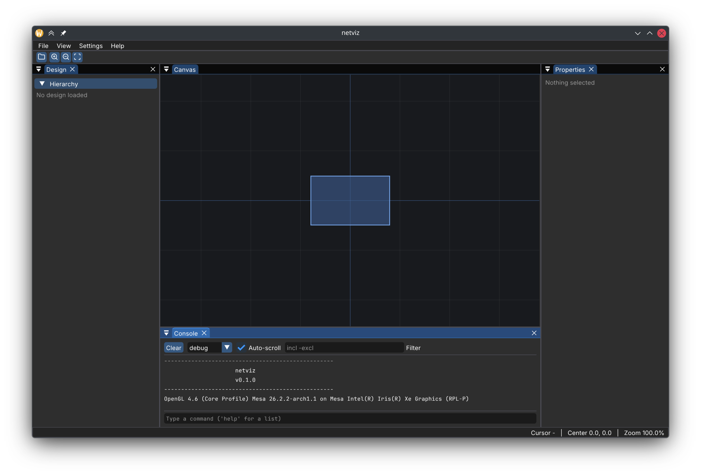

# netviz

An interactive netlist viewer.



> **Status:** early development

## Building

Requires CMake 3.24+, Ninja, a C++20 compiler and OpenGL 3.3. Other dependencies
(SDL3, Dear ImGui) are found or downloaded automatically.

```bash
cmake --preset release
cmake --build --preset release
cmake --install build/release --prefix ~/.local   # optional: puts netviz on your PATH
```

## Using

```bash
netviz [file]                  # if installed
./build/release/netviz [file]  # straight from the build directory
```